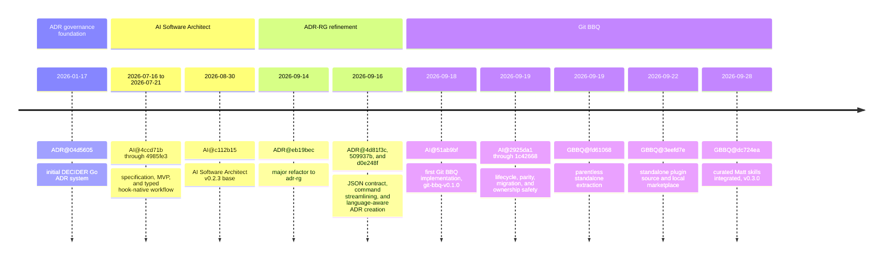
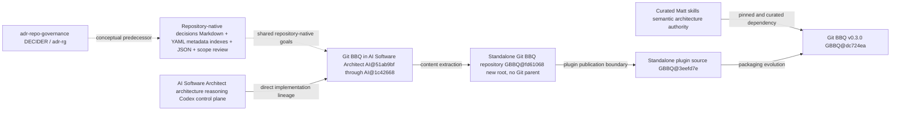

# The Genesis of Git BBQ

**A source-backed history of the ADR, architecture-agent, and plugin lineages**
As of Git BBQ `v0.3.0` (`dc724ea`, 2026-09-28)

## Executive summary

Git BBQ has two important predecessors, but only one direct code lineage.

`adr-repo-governance` is the conceptual predecessor. It established a
repository-native way to keep architecture decisions durable: Markdown for
people, structured metadata for tools, generated indexes, language-aware
scaffolding, and Git-path review. Its Git history is separate from the AI
Software Architect history, and no direct Git parent or repository dependency
connects the two.

AI Software Architect is the direct implementation lineage. It added the
architecture-first reasoning workflow, host-native Codex execution, bounded
repository inspection, lifecycle hooks, approval gates, and validated artifact
bundles. The first Git BBQ implementation appeared inside that repository at
`51ab9bf`, whose parent is AI Software Architect `v0.2.3` (`c112b15`).

Git BBQ then changed the boundary of the product. It moved deterministic
scaffolding and lifecycle enforcement into a Go-first CLI, left semantic
architecture reasoning to Matt Pocock skills and the host-native model, and
made Codex packaging a thin projection of that runtime. The code was extracted
into a parentless standalone repository at `fd61068`, published as a standalone
plugin source at `3eefd7e`, and reached its current curated-skills model at
`dc724ea` / `v0.3.0`.

The shortest accurate description is:

> Git BBQ is a conceptual synthesis of ADR governance and architecture-first
> agent workflows, implemented directly as the Go replacement track inside AI
> Software Architect and then extracted into its own plugin repository.

## How to read the evidence

This report uses four evidence labels:

| Label | Meaning |
| --- | --- |
| **Direct code lineage** | Git parentage, file history, or identical committed file content supports the relationship. |
| **Conceptual predecessor** | Similar contracts, product boundaries, or design goals support the relationship, but Git ancestry does not. |
| **Documented intent** | A README, specification, or handoff states the intended relationship or direction. |
| **Inference** | A synthesis of multiple primary sources. It is marked as such rather than presented as a repository fact. |

The `AGENTS.md`, `CLAUDE.md`, and similar files in the source repositories are
development instructions. They are not silently treated as product-history
evidence. Where an instruction file records a product direction, that statement
is reported as documented intent and checked against commits and source code.

Historical claims use committed Git objects and first-party repository documents.
The source worktrees already contained unrelated uncommitted changes, so those
working-tree changes are excluded from the genealogy.

## Timeline



### Milestone detail

| Date | Repository and commit | What changed | Evidence type |
| --- | --- | --- | --- |
| 2026-01-17 | `adr-repo-governance@04d5605` | Started the DECIDER Go ADR system with the CLI, ADR model, repository layout, and agent-oriented documentation. | Direct code lineage |
| 2026-07-16 to 2026-07-21 | `ai-software-architect@4ccd71b`, `507675f`, `d25c591`, `4985fe3` | Defined and implemented the architecture-first product, then added deterministic hook-based and typed hook-native workflows. | Direct code lineage |
| 2026-08-30 | `ai-software-architect@c112b15` | Established the AI Software Architect `v0.2.3` base from which the first Git BBQ implementation was developed. | Direct parent evidence |
| 2026-09-14 | `adr-repo-governance@eb19bec` | Refactored and renamed the DECIDER-era project to `adr-rg`, preserving the repository-native ADR direction while simplifying the public CLI. | Direct code lineage |
| 2026-09-16 | `adr-repo-governance@4d81f3c`, `509937b`, `d0e248f` | Preserved JSON as the canonical structured-output contract, streamlined ADR commands, and added explicit language-aware ADR creation. | Direct code lineage |
| 2026-09-18 | `ai-software-architect@51ab9bf` | Added `cmd/git-bbq`, `internal/gitbbq`, Git BBQ Codex templates, project contracts, tests, and the first plugin builder. | Direct code lineage |
| 2026-09-19 | `ai-software-architect@2925da1` through `1c42668` | Grew Git BBQ from read-only planning into approval-gated Git execution, remote and release controls, typed hook parity, Go artifact parity, migration, and ownership-safe uninstall. | Direct code lineage |
| 2026-09-19 | `ai-software-architect@1c42668` (`MERGE_ACTION_PLAN.md`) | Recorded the intended workstream for merging `adr-repo-governance` and `ai-software-architect`, while keeping compatibility paths and cutover gates explicit. | Documented intent |
| 2026-09-19 | `git-bbq@fd61068` | Created a new standalone repository containing the Git BBQ runtime, schemas, Codex templates, tests, and packaging workflow. The root commit has no parent. | Direct extraction evidence |
| 2026-09-22 | `git-bbq@3eefd7e` | Added the local marketplace, portable plugin source, validator, branding, installation documentation, and plugin submission materials. Removed the legacy migration adapter from the standalone product. | Direct code lineage |
| 2026-09-28 | `git-bbq@dc724ea` / `v0.3.0` | Integrated the curated Matt-skills source, pinned dependency metadata, curation validation, and the current 16-entrypoint packaging model. | Direct code lineage |

## The two predecessor streams



The solid path is the direct implementation story. The dashed path is a
conceptual or documented relationship. Git BBQ did not begin as a Git merge
commit between the ADR repository and AI Software Architect. The explicit
merge relationship appears in `MERGE_ACTION_PLAN.md`, while the first Git BBQ
commit is a child of AI Software Architect `v0.2.3`.

### What `adr-repo-governance` contributed conceptually

The ADR repository established a durable, repository-native decision surface:

- Markdown records with YAML frontmatter, stable IDs, lifecycle status, scope
  paths, constraints, invariants, and supersession links.
- A generated index that improves retrieval without becoming a second source of
  truth.
- JSON as the stable integration surface for plugins, scripts, CI, and
  architecture tools.
- Language-aware repository scaffolding and explicit Git defaults that remain
  reviewable instead of silently mutating a project.
- Git-path review that surfaces relevant decisions without pretending to prove
  semantic compliance.

Those ideas are visible in the [ADR-RG README](/Users/avery/build/low-level-tools/adr-repo-governance/README.md)
and the [ADR-RG specification](/Users/avery/build/low-level-tools/adr-repo-governance/SPEC.md).
The current source does not identify `adr-repo-governance` as a runtime
dependency of Git BBQ, so this report calls the relationship conceptual rather
than claiming copied code.

### What AI Software Architect contributed directly

AI Software Architect supplied the missing semantic and host-integration layer:

- Architecture-first interviews, option comparison, explicit approval, and
  conformance review.
- Host-native model execution instead of a separate model service.
- Progressive-disclosure skills and focused architecture references.
- Bounded, static repository evidence with no import, build, test, or execution
  of analyzed application code.
- Lifecycle hooks for activation, continuation, checkpointing, validation, and
  safe artifact persistence.
- A validated architecture-artifact bundle rather than isolated, loosely
  related files.

Its README describes the architecture-first workflow and host-native delivery
strategy, while its living specification defines the skill, hook, artifact, and
approval boundaries. The later Go work kept this compatibility path available
while moving new scaffolding and lifecycle work into Git BBQ.

See the [AI Software Architect README](/Users/avery/build/low-level-tools/ai-software-architect/README.md)
and [living specification](/Users/avery/build/low-level-tools/ai-software-architect/specs/AISoftwareArchitect.md)
for those product and control-plane contracts.

## Artifact and responsibility evolution

### Artifact source of truth

| Stage | Semantic source of truth | Generated or operational projections | Key shift |
| --- | --- | --- | --- |
| `adr-repo-governance` | `docs/adr/NNNN-kebab-case-title.md` with rich YAML frontmatter | `docs/adr/index.yaml`; JSON CLI responses | Decisions are repository-native and queryable by scope. |
| Legacy AI Software Architect | `.ai-architect/project-context.md`, `.ai-architect/decisions/ADR-NNN[-slug].md`, and the architecture contract | `.ai-architect/decisions/index.json`, implementation plan, Codex-managed state | Architecture reasoning and four-artifact persistence are guarded by the host adapter. |
| Git BBQ current model | `CONTEXT.md` plus `docs/adr/NNNN-slug.md` using the Matt-native format | `architecture-contract.yaml`, `implementation-plan.md`, `docs/adr/index.json`, `.gitbbq-manifest.yaml`, `.githabits.yaml`, and `.gitbbq/` operational state | One semantic document set is projected into machine-readable views; Git policy is explicit and separate. |

This is a replacement of the legacy artifact boundary, not a silent rename.
Git BBQ preserves existing AI Software Architect files during its compatibility
and migration work, but new Git BBQ projects do not create a second
`.ai-architect` decision set.

The format and migration contrast is documented by the [ADR-RG
specification](/Users/avery/build/low-level-tools/adr-repo-governance/SPEC.md),
the [Go migration track](/Users/avery/build/low-level-tools/ai-software-architect/docs/GO_MIGRATION.md),
and the [Git BBQ operating contract](/Users/avery/build/low-level-tools/git-bbq/docs/GIT_BBQ.md).

### Ownership boundaries

| Capability | `adr-repo-governance` | AI Software Architect | Git BBQ today |
| --- | --- | --- | --- |
| Semantic architecture reasoning | Explicitly out of scope | Host-native model plus architecture skills | Matt skills plus host-native model |
| ADR storage and validation | Primary responsibility | Part of a validated architecture bundle | Go runtime stores and validates Matt-native ADRs |
| Repository scaffolding | Agent files and language guidance | Architecture project scaffold and compatibility CLI | Go-first project scaffold with language skills and project contract |
| Git lifecycle | Records defaults and reviews changed paths | Plans and executes only with explicit approval | `githabits` plans and executes guarded actions with approval |
| Host integration | JSON/CLI integration surface | Python/Pydantic Codex control plane and optional MCP | Go hook runtime, portable manifest, and Codex compatibility packaging |
| Application-source mutation | Not performed by the ADR tool | Protected; only approved architecture artifacts are writable | Existing files are preserved by default; generated ownership and uninstall are guarded |

## How Git BBQ became the current plugin

The first Git BBQ slice was deliberately additive. The [Go migration
track](/Users/avery/build/low-level-tools/ai-software-architect/docs/GO_MIGRATION.md)
describes the split: Matt skills own semantic architecture language and ADR
behavior, while Git BBQ owns scaffolding, projections, lifecycle enforcement,
and Codex integration. The old `.ai-architect` path remained intact until a
separate cutover could be justified.

The September 19 implementation sequence filled out the deterministic control
plane in layers:

1. `git-bbq-v0.1.0` established the Go scaffold, project contracts, hooks, and
   plugin builder.
2. `v0.1.1` through `v0.1.3` added read-only Git planning, approval-gated
   execution, repository initialization, and branch/bootstrap actions.
3. `v0.1.4` through `v0.1.9` added remote setup, persisted remote state,
   approved push verification, SemVer release guards, and GitHub provider
   provisioning.
4. `v0.1.10` through `v0.1.13` added typed hook lifecycle parity, Go contract
   and artifact parity, cross-platform packaging, and language-profile parity.
5. `v0.1.14` through `v0.1.17` added legacy migration assessment/apply and
   ownership-safe uninstall while compatibility was still in-tree.

The in-tree release tags make that acceleration auditable:

| Tag | Commit | Capability checkpoint |
| --- | --- | --- |
| `git-bbq-v0.1.0` | `51ab9bf` | Go scaffold and project contract foundation |
| `git-bbq-v0.1.1` | `2925da1` | Read-only `githabits` planning |
| `git-bbq-v0.1.2` | `cee98c5` | Approval-gated Git execution |
| `git-bbq-v0.1.3` | `b7bb753` | Bootstrap and repository initialization actions |
| `git-bbq-v0.1.4` | `f114bb6` | Approval-gated remote setup |
| `git-bbq-v0.1.5` | `43b0f9f` | Persist configured remote state |
| `git-bbq-v0.1.6` | `32331de` | Approved push lifecycle verification |
| `git-bbq-v0.1.7` | `7880668` | SemVer and annotated-tag policy |
| `git-bbq-v0.1.8` | `3e46677` | Release progression and observed-tag protection |
| `git-bbq-v0.1.9` | `45e0951` | Approval-gated provider provisioning |
| `git-bbq-v0.1.10` | `5b25370` | Typed Codex hook lifecycle parity |
| `git-bbq-v0.1.11` | `3a27ed8` | Go contract and artifact parity |
| `git-bbq-v0.1.12` | `dcc21e2` | Cross-platform release packaging |
| `git-bbq-v0.1.13` | `6428c9e` | Java and C# scaffold profile parity |
| `git-bbq-v0.1.14` | `45b8eb0` | Legacy migration assessment |
| `git-bbq-v0.1.15` | `7ffb8e3` | Approved legacy migration |
| `git-bbq-v0.1.16` | `35c5726` | Migration progress handoff |
| `git-bbq-v0.1.17` | `1c42668` | Ownership-safe uninstall |

At extraction, the standalone root was intentionally new rather than a Git
merge. The next publication commit made the plugin self-contained: it added the
local marketplace and package validator, and removed `internal/gitbbq/migration.go`
and `internal/legacyarchitect/legacy.go`. That is the point where Git BBQ stops
being merely a migration slice inside the architecture-agent repository and
becomes an independently packaged product.

## Git BBQ as it exists today

The standalone repository describes Git BBQ as a Go-first scaffolding and
lifecycle layer around host-native architecture skills. Its current contract
has four visible layers:

| Layer | Current responsibility | Representative source |
| --- | --- | --- |
| Semantic layer | Matt-native architecture vocabulary, ADRs, context, and reasoning | `.agents/skills/`, `CONTEXT.md`, `docs/adr/` |
| Deterministic runtime | Scaffolding, validation, projections, dependency pins, ownership, and guarded Git actions | `cmd/git-bbq/`, `internal/gitbbq/`, `schemas/gitbbq/` |
| Codex control surface | Structured plugin identity, five lifecycle hooks, launchers, and compatibility metadata | `adapters/codex/templates/git-bbq-*` |
| Distribution | Portable package build, target runtimes, curated skill manifest, validator, and local marketplace | `scripts/build_git_bbq_plugin.py`, `scripts/validate_git_bbq_plugin.py`, `.agents/plugins/marketplace.json` |

The current plugin is intentionally not a second model runtime. It is a
skills-plus-hooks plugin with a dependency-free Go runtime. The host remains
responsible for reasoning, permissions, and final approval.

The standalone [Git BBQ operating contract](/Users/avery/build/low-level-tools/git-bbq/docs/GIT_BBQ.md)
and [plugin submission handoff](/Users/avery/build/low-level-tools/git-bbq/docs/PLUGIN_SUBMISSION.md)
define the five-hook, skills-only, approval-gated package boundary.

The current project contract includes:

- `CONTEXT.md` and `docs/adr/` as semantic sources of truth.
- `.gitbbq-manifest.yaml` for project, language, dependency, and hook metadata.
- `.githabits.yaml` for independent initialization, branch, stage, commit, tag,
  remote, and push policy.
- Generated architecture-contract, implementation-plan, and ADR-index views.
- Five required lifecycle events: `UserPromptSubmit`, `PreToolUse`, `PostToolUse`,
  `PostCompact`, and `Stop`.
- A pinned and curated Matt-skills dependency. At `v0.3.0`, the package records
  16 canonical public entrypoints and the exact source pin used to build them.

## Claims, caveats, and uncertainties

### Supported claims

- **Direct code lineage:** `ai-software-architect@51ab9bf` is a child of
  `c112b15` and introduces the Git BBQ implementation.
- **Standalone extraction:** `git-bbq@fd61068` is a parentless root commit with
  the Git BBQ runtime and packaging source.
- **Plugin publication:** `git-bbq@3eefd7e` adds the standalone plugin
  marketplace and validator and removes the legacy migration adapter.
- **Current endpoint:** `git-bbq@dc724ea` is tagged `v0.3.0` and integrates the
  curated Matt-skills source.
- **Conceptual predecessor:** ADR-RG and Git BBQ share repository-native ADR,
  generated-index, language-scaffold, and explicit-Git-policy concerns, but the
  repositories have separate histories.

### Important caveats

- The standalone extraction was not a byte-for-byte snapshot of every file:
  selected core files have identical committed blobs between the AI repository's
  extraction-era endpoint and `fd61068`, while scaffold code changed during the
  extraction. The report therefore says “content extraction,” not “Git fork.”
- `MERGE_ACTION_PLAN.md` documents an intended merge workstream. It does not
  prove that `adr-repo-governance` code was directly copied into Git BBQ.
- The report describes the repository state through `v0.3.0`; it does not infer
  future Python retirement or a completed production cutover from roadmap text.

## Evidence appendix

### Primary repositories

| Alias | Checkout | Primary evidence |
| --- | --- | --- |
| ADR | `/Users/avery/build/low-level-tools/adr-repo-governance` | [README](/Users/avery/build/low-level-tools/adr-repo-governance/README.md), [SPEC](/Users/avery/build/low-level-tools/adr-repo-governance/SPEC.md), `docs/adr/` |
| AI | `/Users/avery/build/low-level-tools/ai-software-architect` | [README](/Users/avery/build/low-level-tools/ai-software-architect/README.md), [GO_MIGRATION](/Users/avery/build/low-level-tools/ai-software-architect/docs/GO_MIGRATION.md), [MERGE_ACTION_PLAN](/Users/avery/build/low-level-tools/ai-software-architect/MERGE_ACTION_PLAN.md), `cmd/git-bbq/`, `internal/gitbbq/` |
| GBBQ | `/Users/avery/build/low-level-tools/git-bbq` | [README](/Users/avery/build/low-level-tools/git-bbq/README.md), [GIT_BBQ](/Users/avery/build/low-level-tools/git-bbq/docs/GIT_BBQ.md), plugin templates, runtime, schemas, and packaging scripts |

### Reproducible Git checks

The following commands reproduce the key lineage claims:

```sh
git -C /Users/avery/build/low-level-tools/ai-software-architect \
  show -s --format='commit=%H%nparent=%P%ntag=%D%nsubject=%s' 51ab9bf

git -C /Users/avery/build/low-level-tools/git-bbq \
  show -s --format='commit=%H%nparent=%P%ntag=%D%nsubject=%s' fd61068

git -C /Users/avery/build/low-level-tools/git-bbq \
  show -s --format='%H%n%aI%n%D%n%s' dc724ea
```

For the extraction comparison, the committed blobs for
`cmd/git-bbq/main.go`, `internal/gitbbq/model.go`,
`internal/gitbbq/githabits.go`, and the Git BBQ plugin templates match between
the AI repository's `1c42668` endpoint and standalone `fd61068`; the scaffold
file differs. This supports extraction with targeted adaptation, not a claim
that the two repositories share Git ancestry.

### Marketplace and visual-tool decision

Plugin Management search identified tldraw, Whimsical, and Miro as available
visual integrations, but none was installed or connected. This report uses
portable Mermaid source and Markdown tables instead. No external plugin,
account, board, or remote artifact is required to inspect or reproduce the
history.
